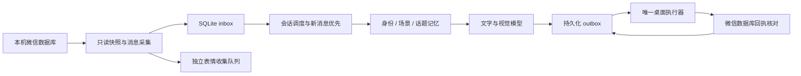

# 小i · WeChat Agent

运行在 Linux 桌面微信上的个人 AI 助手。项目通过本机数据库读取消息，用桌面界面完成发送、原生表情和朋友圈操作，并用 SQLite 保存处理状态与记忆。

这是从已部署实例整理出的源码版本，包含运行模块、回归测试和部署示例。配置、账号数据、聊天记录、密钥、图片和表情原文件不在仓库中。

## 已实现的能力

- 私聊自动回复，群聊精确识别 @，结合最近群聊上下文判断是否接话。
- 新消息优先处理，模型请求与界面操作分开，发送前核对账号及目标会话。
- 一次回复可分为两三条短消息，支持可配置人格、称呼、兴趣和场景记忆。
- 在确认同一人身份后关联私聊与群聊；普通身份信息可共享，具体聊天内容按场景使用。
- 原图与动态表情多帧理解、素材去重保存、微信原生收藏及表情选择发送。
- 可选语音回复、任务处理、反馈学习、群聊话题状态和质量检查。
- 朋友圈发布、扫描、点赞、评论以及回复自己动态下的评论，带每日额度与去重。
- 持久化 inbox/outbox、回执检查、重启恢复和运行指标。

最新响应与可靠性改动、查询指令和限制见 [r10 说明](docs/RELIABILITY_R10.md)。

## 处理流程



收消息主要走数据库增量读取。截图仍用于方向判断、定位和部分媒体识别；发送、收藏及朋友圈仍依赖桌面界面。

## 运行条件

- Linux 图形会话、可运行且已登录的 Linux 微信客户端。
- X11/XTest、AT-SPI、GTK/GDK；无头服务器也需要实际的虚拟桌面会话。
- Python 3.10+、本机 OpenSSL，以及具备权限的微信数据库和媒体密钥文件。
- 支持所需协议的聊天模型；识图须单独配置真正接受图片输入的模型。
- 动态表情解码需要 FFmpeg；OCR 需要 Tesseract 及相应语言包。

仓库不附带微信客户端、登录态或密钥提取工具。桌面布局和微信版本会影响界面定位，不能只安装 Python 包就直接运行。

## 安装与配置

以下为 Ubuntu/Debian 环境的安装示例，先在自己的测试账号和桌面会话验证。

```bash
sudo apt-get install python3-venv python3-gi python3-pyatspi \
  gir1.2-gtk-3.0 gir1.2-gdkpixbuf-2.0 libxtst6 libssl3 \
  ffmpeg tesseract-ocr tesseract-ocr-chi-sim
python3 -m venv --system-site-packages .venv
.venv/bin/python -m pip install -r requirements.txt
# 可选语音及 SQLCipher 支持：
.venv/bin/python -m pip install -r requirements-optional.txt
cp config.example.json config.json
```

编辑 `config.json`：设置聊天模型、API 文件路径、自己账号的群内称呼、数据库密钥文件和私有缓存路径。API 文件格式参见 `.env.example`，不要把真实密钥写进 Git。视觉、主动接话、表情发送和朋友圈在示例中保持关闭，按需要配置后开启。

```bash
.venv/bin/python bridge.py --self-check
.venv/bin/python bridge.py --config config.json
```

前台运行确认后，再根据 [部署说明](docs/DEPLOYMENT.md) 配置 systemd。已经有正在运行的实例时，勿同时启动第二个执行器。

## 测试

```bash
python -m unittest discover -s . -p 'test_*.py'
```

测试使用合成数据和 mock，不向真实联系人发消息。部分 GTK/图像测试需要 Linux 桌面依赖；Windows 会跳过不支持的平台检查。实际测试结果写在 [验证记录](docs/VALIDATION.md)，真机行为还需要收件端验收。

## 继续开发

- [六项能力的配置与微信指令](docs/SIX_CAPABILITIES_USAGE.md)

- [文件地图、关键约束与待办](docs/HANDOFF.md)
- [部署、配置与回滚](docs/DEPLOYMENT.md)
- `SOURCE_SHA256.json`：整理时服务器运行模块的 SHA-256，便于核对源码来源。

原文件入库、微信收藏、原生发送及对方收件是不同状态。结果未知的操作只核对回执，不自动重复提交。当前界面自动化仍有漏定位和控件变化的限制；批量保存原文件成功，也不代表已经全部加入微信收藏。
